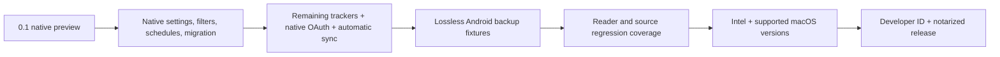

# macOS parity and verification

Target: full Mihon Android feature parity, including tracking and backups. Current release: **0.1 native preview**, with a bundled compatibility engine. A working Mac build does not establish parity.

## Current coverage

| Area | Native preview | Verification / remaining gate |
|---|---|---|
| Install and launch | Self-contained `.app`, icon, ad-hoc signature, DMG | Final DMG checksum, mounted app signature and executable match verified; copied from DMG into the user's Applications folder and launched with its own empty library. No notarization or Intel/older-macOS verification yet |
| Library | Covers, search, categories, add/remove, history | Local fixtures exercised; no-match search checked in actual UI |
| Sources | Extension repositories, install/update/uninstall, popular/latest/search/pagination | Keiyoushi catalog and MANGA Plus install, catalog, chapters, and page images exercised; other extensions not certified |
| Source preferences / filters | Available in bundled local web control panel | Native typed controls and representative source tests remain |
| Local comics | CBZ/ZIP, image folders, chapter-series folders, copies without overwriting | Actual native CBZ import plus import-layout/recursive-copy checks |
| Reader | Paged and Webtoon, right-to-left, dark background, zoom, next/previous chapter, progress | Generated comic pages and online publisher pages; full Android viewer modes and per-title preferences remain |
| Chapters | Read/unread, bookmarks, offline download action | Persistence checked; a 53-page MANGA Plus chapter downloaded through the native action |
| Downloads | Native queue, start/pause/remove/clear | Live engine schema, completed download, restart, and downloaded-page rendering with blocked outbound source requests verified |
| Updates | Native recent chapters, manual library update | Engine endpoints and empty native screen checked; scheduling UI remains in local control panel |
| Backups | Validate, merge restore, export, original-input archive, pre-restore recovery | Fresh-database round-trip passed; actual macOS export/restore dialogs, original-input archive hash, and recovery gzip checked; real Android backup fixture remains required |
| Tracking | Six services, login UI, title search/link/status/manual progress sync | Service enumeration only; actual account authorization/sync not yet tested |
| Migration / automation | Local control panel | Native flows remain |
| WebView-dependent sources | Engine HTTP support | Native cookie/challenge interaction and source compatibility remain |

## Tracking gaps

The user selected **AniList** as the first account integration to verify. The bundled engine offers MyAnimeList, AniList, Kitsu, MangaUpdates, Shikimori, and Bangumi. The pinned Mihon source additionally includes **Komga, Kavita, Suwayomi, Hikka, MangaBaka, and Comick**. Those six integrations are not implemented here. Browser OAuth presently requires copying the redirected URL into the connection sheet; AniList also supports a token input. An automatic native callback flow remains to be built.

The preview provides manual progress synchronization. Automatic synchronization, scores/dates and all Android tracker capabilities must be completed and checked with the user’s services before claiming parity. Credentials are never needed for the build or local tests.

## Backup gaps

The engine supports core library, chapters, categories, sources, history, and supported tracking records. Its protobuf model does not retain all Mihon fields:

- Android application preferences, source preferences, and extension stores.
- Manga notes, excluded scanlators, and some update/favorite metadata.
- Records for trackers it does not implement cannot be claimed as migrated correctly.

The original import is archived byte-for-byte before restoration, alongside a pre-restore recovery snapshot. That protects the input; it does not make an engine export lossless. A native preservation/merge layer or backend schema changes, plus field-by-field Android fixtures, are required for full backup fidelity. Media files are separate from library backups on both platforms.

The [research report](PORT_RESEARCH.md) links the exact Mihon and engine schema definitions supporting these differences.

## Verification record

Environment: 12 October 2026, Apple Silicon, macOS 27.0, Swift 6.4 command-line tools. Mihon base `143a060ac9dbbe1f574d0b4f6e9f76baf4135f59`; engine `2.4.2366`. The engine is the unmodified official release jar, SHA-256 `af9feb20af9d7ebe9e30769e6c6ebc7fc7ab1c447388d42e0280b1da5fe07bfd`.

`macos/scripts/test.sh` uses standalone Swift checks because the installed command-line tools do not include a usable XCTest/Swift Testing runtime. It also launches the actual bundled engine in isolated temporary data directories. It does not fabricate engine responses.

The integration suite checks fresh startup; local source discovery; CBZ chapters and PNG bytes; saved page/read/bookmark state; library and history totals; category mapping; the live downloads GraphQL schema; no preconfigured third-party repositories; six tracker services; updates endpoints; gzip protobuf export and validation; persistence after restart; and restoration into a second fresh database. It leaves the user library untouched.

The standalone suite passed **five Swift checks and seventeen actual-engine checks**. Native UI verification includes title/details navigation, resume and page navigation, no-match search, file import, extension install, source selection, actual online page display, Webtoon resume and forward/reverse scroll progress without marking preloaded pages read, and native backup export/restore confirmation and completion. The archive retained the import byte-for-byte and a valid gzip recovery backup.

The supplied Keiyoushi index exposed 1,433 extensions during this session. MANGA Plus by SHUEISHA extension 1.6.66 installed and exposed its English catalog. A 53-page first chapter was downloaded through its native chapter action. After restarting the engine with HTTP and HTTPS routed to an unavailable local proxy, a fresh source-catalog request failed with `Failed to connect to 127.0.0.1:9`; the downloaded page still returned 1,167,697 image bytes, and the native reader resumed its saved second page. This is a controlled engine-only offline test; the Mac’s network settings were not changed.

These results cover that publisher source and generated local fixtures. They do not prove every Keiyoushi source, actual Android backup, or authenticated AniList operation works.

## Gates to full parity

Each gate needs implementation and runtime evidence. A web control-panel fallback, exposed backend API, passing build, or tracker appearing in a list does not satisfy its native acceptance gate.
