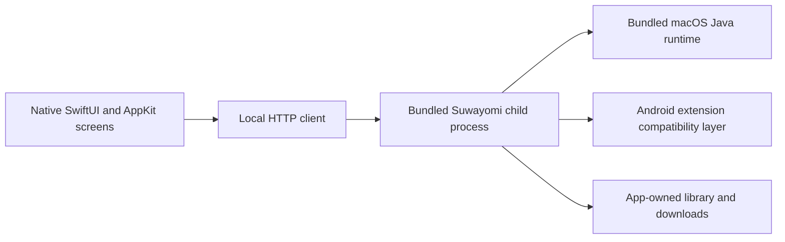
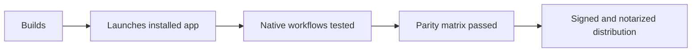

# Native macOS port research

Research date: 12 October 2026. User target: full Mihon feature parity with a native, installable Mac application.

Inspected source versions:

- Mihon `143a060ac9dbbe1f574d0b4f6e9f76baf4135f59` (the checked-out upstream source).
- Suwayomi Server `v2.4.2366`, commit `40bc5da57820324ed0ae724cbbc020cc4673b594` (read-only research checkout).

This is an architecture and API investigation, not evidence that any native feature, particular extension, tracker login, or backup migration has passed runtime testing.

## Recommendation

Build the user-facing application in SwiftUI and AppKit. Bundle Suwayomi Server and its macOS Java runtime as a separate child process, and communicate with it over a private localhost HTTP API. Suwayomi already executes Mihon/Tachiyomi extensions and exposes library, source, download, tracking, and backup services. Its official distribution supports macOS arm64 and x64. That avoids rebuilding an Android compatibility runtime inside Swift. [Suwayomi README](https://github.com/Suwayomi/Suwayomi-Server/blob/40bc5da57820324ed0ae724cbbc020cc4673b594/README.md)

The application is native when its windows, navigation, library, reader, settings, and interaction are implemented using Apple frameworks. Merely embedding the bundled web interface would produce a browser interface inside a Mac window. The Java backend does not preclude a native UI; it means the backend is JVM-based. These are architectural interpretations, not claims made by Mihon upstream.

Keep the Android tree intact and place the Mac application and packaging work in a dedicated directory. Retain attribution and license notices. Mihon is Apache 2.0; Suwayomi is MPL 2.0, so its source/license obligations are separate. [Mihon license](https://github.com/mihonapp/mihon/blob/143a060ac9dbbe1f574d0b4f6e9f76baf4135f59/LICENSE), [Suwayomi license](https://github.com/Suwayomi/Suwayomi-Server/blob/40bc5da57820324ed0ae724cbbc020cc4673b594/LICENSE)

## Why the existing app cannot be rebuilt unchanged for Mac

Mihon's `app` uses the Android application plugin and Android Compose/AndroidX dependencies. Its `domain`, `data`, and `source-api` modules also use Android library plugins. The data module uses SQLDelight with Android SQLite dependencies. There is no ready-made Apple framework target in those inspected build files. [App build](https://github.com/mihonapp/mihon/blob/143a060ac9dbbe1f574d0b4f6e9f76baf4135f59/app/build.gradle.kts), [Domain build](https://github.com/mihonapp/mihon/blob/143a060ac9dbbe1f574d0b4f6e9f76baf4135f59/domain/build.gradle.kts), [Data build](https://github.com/mihonapp/mihon/blob/143a060ac9dbbe1f574d0b4f6e9f76baf4135f59/data/build.gradle.kts), [Source API build](https://github.com/mihonapp/mihon/blob/143a060ac9dbbe1f574d0b4f6e9f76baf4135f59/source-api/build.gradle.kts)

The extension loader relies on Android `Context`, `PackageManager`, APK package metadata/signatures, and a Dalvik-compatible class loader. An APK is therefore not a native macOS plugin that SwiftUI can load directly. A compatibility engine or source-by-source rewrite is required. [ExtensionLoader](https://github.com/mihonapp/mihon/blob/143a060ac9dbbe1f574d0b4f6e9f76baf4135f59/app/src/main/java/eu/kanade/tachiyomi/extension/util/ExtensionLoader.kt)

Kotlin/Native can expose Kotlin as an Apple framework to Swift. However, that requires extracting platform-neutral code and replacing its Android/JVM dependencies. It does not convert Dalvik APK extensions into native Apple binaries. It is a possible later shared-model project, not the shortest route to a working Mac application with existing sources. [Kotlin Apple-framework interoperability](https://kotlinlang.org/docs/apple-framework.html)

## API map for the bundled version

REST routes are mounted under `/api/v1/`; GraphQL HTTP and WebSocket are mounted at `/api/graphql`. The GraphQL backup download route is `/api/graphql/files/backup/{file}`. Use the pinned server's generated schema/introspection to confirm operation selections and scalar representation before coding the client. [Route mount](https://github.com/Suwayomi/Suwayomi-Server/blob/40bc5da57820324ed0ae724cbbc020cc4673b594/server/src/main/kotlin/suwayomi/tachidesk/server/JavalinSetup.kt), [GraphQL routes](https://github.com/Suwayomi/Suwayomi-Server/blob/40bc5da57820324ed0ae724cbbc020cc4673b594/server/src/main/kotlin/suwayomi/tachidesk/graphql/GraphQL.kt)

| Native feature | Backend entry points | Implementation note |
|---|---|---|
| Sources | `GET source/list`; `GET source/{sourceId}` | Preserve 64-bit source IDs exactly. |
| Source browsing | `GET source/{id}/popular/{page}`; `GET source/{id}/latest/{page}` | Honor `supportsLatest` and pagination. |
| Source search | `GET source/{id}/search?searchTerm=…&pageNum=…` | Native global search must fan out; global REST route is commented out. |
| Source settings/filter forms | `GET/POST source/{id}/preferences`; `GET/POST source/{id}/filters` | Build native controls for each returned type. |
| Extension management | `GET extension/list`, `GET extension/install/{pkgName}`, `GET extension/update/{pkgName}`, `GET extension/uninstall/{pkgName}`; `POST extension/install` | These GET routes perform mutations; invoke only for explicit UI actions. |
| Library and categories | `GET category`; `GET category/{id}`; add/remove through `manga/{id}/library` and `manga/{id}/category/{categoryId}` | Native filtering and category UI still required. |
| Manga, chapters, pages | `GET manga/{id}/full`; `GET manga/{id}/chapters`; `GET manga/{id}/chapter/{index}`; `GET manga/{id}/chapter/{index}/page/{page}` | Reader must implement navigation, image display, settings, and progress saving. |
| Progress/bookmarks | `PATCH manga/{id}/chapter/{index}` and chapter batch routes | Confirm request fields in controller/schema. |
| Downloads | `GET download/{mangaId}/chapter/{index}`; DELETE equivalent; `downloads/start`, `stop`, `clear`; download WebSocket | Native queue, errors, pause/resume, deletion, and offline behavior need testing. |
| Updates | `POST update/fetch`; `GET update/summary`; `GET update/recentChapters/{page}`; update WebSocket | UI and scheduled behavior are separate acceptance checks. |

Route source: [MangaAPI](https://github.com/Suwayomi/Suwayomi-Server/blob/40bc5da57820324ed0ae724cbbc020cc4673b594/server/src/main/kotlin/suwayomi/tachidesk/manga/MangaAPI.kt). Search query parameters and upload handling: [SourceController](https://github.com/Suwayomi/Suwayomi-Server/blob/40bc5da57820324ed0ae724cbbc020cc4673b594/server/src/main/kotlin/suwayomi/tachidesk/manga/controller/SourceController.kt), [ExtensionController](https://github.com/Suwayomi/Suwayomi-Server/blob/40bc5da57820324ed0ae724cbbc020cc4673b594/server/src/main/kotlin/suwayomi/tachidesk/manga/controller/ExtensionController.kt).

GraphQL offers `fetchSourceManga` input `{source, type, page, query?, filters?}` where type is `SEARCH`, `POPULAR`, or `LATEST`; `source` exposes `preferences` and `filters`; `updateSourcePreference` accepts typed state changes by position. Extension stores have `extensionStores`, `addExtensionStore({indexUrl})`, and `removeExtensionStore({indexUrl})`. Extension actions also have `updateExtension`/`updateExtensions`, `fetchExtensions`, and `installExternalExtension`. [Source mutations](https://github.com/Suwayomi/Suwayomi-Server/blob/40bc5da57820324ed0ae724cbbc020cc4673b594/server/src/main/kotlin/suwayomi/tachidesk/graphql/mutations/SourceMutation.kt), [Source types](https://github.com/Suwayomi/Suwayomi-Server/blob/40bc5da57820324ed0ae724cbbc020cc4673b594/server/src/main/kotlin/suwayomi/tachidesk/graphql/types/SourceType.kt), [Extension store mutations](https://github.com/Suwayomi/Suwayomi-Server/blob/40bc5da57820324ed0ae724cbbc020cc4673b594/server/src/main/kotlin/suwayomi/tachidesk/graphql/mutations/ExtensionStoreMutation.kt), [Extension mutations](https://github.com/Suwayomi/Suwayomi-Server/blob/40bc5da57820324ed0ae724cbbc020cc4673b594/server/src/main/kotlin/suwayomi/tachidesk/graphql/mutations/ExtensionMutation.kt)

## Backups: useful migration, incomplete parity

Mihon uses protobuf, potentially gzip-compressed. Its decoder accepts gzip or raw protobuf and explicitly rejects legacy JSON. Official supported backup formats are `.tachibk`/`.proto.gz`; downloaded chapter files, installed extensions, and custom covers are not included. Backups contain library/chapter/category/history/tracker data and optionally settings/repositories/source preferences. [Backup decoder](https://github.com/mihonapp/mihon/blob/143a060ac9dbbe1f574d0b4f6e9f76baf4135f59/app/src/main/java/eu/kanade/tachiyomi/data/backup/BackupDecoder.kt), [Official backup guide](https://mihon.app/docs/guides/backups)

Suwayomi REST provides:

- `POST /api/v1/backup/validate` with raw backup bytes; returns missing-source/tracker information.
- `POST /api/v1/backup/import` with raw backup bytes; restores and returns validation information.
- `GET /api/v1/backup/export` with an octet-stream response.
- `/validate/file` and `/import/file` multipart variants whose field name must be `backup.proto.gz`.
- `GET /api/v1/backup/export/file` with a suggested filename in `Content-Disposition`.

These call `restoreLegacy` and default backup flags. For progress and selected flags, prefer GraphQL `validateBackup`, `restoreBackup`, `restoreStatus`, and `createBackup`; the latter returns a temporary download URL. GraphQL restore uploads a file and returns an operation ID/status. [BackupController](https://github.com/Suwayomi/Suwayomi-Server/blob/40bc5da57820324ed0ae724cbbc020cc4673b594/server/src/main/kotlin/suwayomi/tachidesk/manga/controller/BackupController.kt), [Backup mutations](https://github.com/Suwayomi/Suwayomi-Server/blob/40bc5da57820324ed0ae724cbbc020cc4673b594/server/src/main/kotlin/suwayomi/tachidesk/graphql/mutations/BackupMutation.kt), [Backup queries](https://github.com/Suwayomi/Suwayomi-Server/blob/40bc5da57820324ed0ae724cbbc020cc4673b594/server/src/main/kotlin/suwayomi/tachidesk/graphql/queries/BackupQuery.kt)

Important schema gaps in the pinned engine:

| Mihon field | Present in pinned Suwayomi model? | Consequence |
|---|---|---|
| Library/categories/sources/chapters/tracking/history | Yes | Core migration is available; still test real fixtures. |
| App preferences `104`, source preferences `105`, extension stores `106` | No in top-level Backup | Do not claim settings/repository round-trip fidelity. |
| Manga excluded scanlators `108`, notes `110`, next update `113`, favorite modified time `107` | No in BackupManga | Some Android metadata can be lost on export/import. |
| Downloaded media and installed extensions | Not included by Mihon's format | Must be transferred or installed separately. |

Comparison sources: [Mihon Backup](https://github.com/mihonapp/mihon/blob/143a060ac9dbbe1f574d0b4f6e9f76baf4135f59/app/src/main/java/eu/kanade/tachiyomi/data/backup/models/Backup.kt), [Suwayomi Backup](https://github.com/Suwayomi/Suwayomi-Server/blob/40bc5da57820324ed0ae724cbbc020cc4673b594/server/src/main/kotlin/suwayomi/tachidesk/manga/impl/backup/proto/models/Backup.kt), [Mihon BackupManga](https://github.com/mihonapp/mihon/blob/143a060ac9dbbe1f574d0b4f6e9f76baf4135f59/app/src/main/java/eu/kanade/tachiyomi/data/backup/models/BackupManga.kt), [Suwayomi BackupManga](https://github.com/Suwayomi/Suwayomi-Server/blob/40bc5da57820324ed0ae724cbbc020cc4673b594/server/src/main/kotlin/suwayomi/tachidesk/manga/impl/backup/proto/models/BackupManga.kt).

Recommendation: always retain the original Android backup, validate before importing, present missing dependencies, and add a lossless import-preservation layer or engine changes before claiming full fidelity.

## Tracking API and actual tracker gap

REST `GET /api/v1/track/list` reports supported trackers. Login is `POST /track/login` with `{trackerId, callbackUrl?}` for OAuth or `{trackerId, username?, password?}` for credentials. Logout takes `{trackerId}`; search takes `{trackerId, title}`. Bind uses query parameters `mangaId`, `trackerId`, `remoteId`, and `private`. Update takes `{recordId, status?, lastChapterRead?, scoreString?, startDate?, finishDate?, unbind?, private?}`. [TrackController](https://github.com/Suwayomi/Suwayomi-Server/blob/40bc5da57820324ed0ae724cbbc020cc4673b594/server/src/main/kotlin/suwayomi/tachidesk/manga/controller/TrackController.kt), [Track input models](https://github.com/Suwayomi/Suwayomi-Server/blob/40bc5da57820324ed0ae724cbbc020cc4673b594/server/src/main/kotlin/suwayomi/tachidesk/manga/impl/track/Track.kt)

GraphQL additionally exposes `loginTrackerOAuth`, `loginTrackerCredentials`, `logoutTracker`, `bindTrack`, `bindTrackRecord`, `fetchTrack`, `unbindTrack`, `trackProgress`, and `updateTrack`. `trackers`/`tracker` expose `authUrl`, `isLoggedIn`, statuses, scores, and feature capability flags; `searchTracker` accepts `{trackerId, query}`. Native OAuth needs an actual callback capture mechanism and a tested exchange, not simply opening the auth URL. [Track mutations](https://github.com/Suwayomi/Suwayomi-Server/blob/40bc5da57820324ed0ae724cbbc020cc4673b594/server/src/main/kotlin/suwayomi/tachidesk/graphql/mutations/TrackMutation.kt), [Track queries](https://github.com/Suwayomi/Suwayomi-Server/blob/40bc5da57820324ed0ae724cbbc020cc4673b594/server/src/main/kotlin/suwayomi/tachidesk/graphql/queries/TrackQuery.kt), [Track types](https://github.com/Suwayomi/Suwayomi-Server/blob/40bc5da57820324ed0ae724cbbc020cc4673b594/server/src/main/kotlin/suwayomi/tachidesk/graphql/types/TrackType.kt)

| Tracker | Mihon source | Suwayomi v2.4.2366 |
|---|---|---|
| MyAnimeList, AniList, Kitsu, MangaUpdates, Shikimori, Bangumi | Implemented | Implemented |
| Komga, Kavita, Suwayomi, Hikka, MangaBaka, Comick | Implemented | Not in active service list |

Sources: [Mihon TrackerManager](https://github.com/mihonapp/mihon/blob/143a060ac9dbbe1f574d0b4f6e9f76baf4135f59/app/src/main/java/eu/kanade/tachiyomi/data/track/TrackerManager.kt), [Suwayomi TrackerManager](https://github.com/Suwayomi/Suwayomi-Server/blob/40bc5da57820324ed0ae724cbbc020cc4673b594/server/src/main/kotlin/suwayomi/tachidesk/manga/impl/track/tracker/TrackerManager.kt). Backend inclusion is not proof that third-party authentication works today.

## Packaging and completion boundaries

Run the engine with an app-specific root directory through `-Dsuwayomi.tachidesk.config.server.rootDir=…`. Its default root is the shared Tachidesk data directory; overriding it prevents accidental use of an unrelated existing Suwayomi installation. Bind to loopback, use a private local authentication policy, disable automatic browser launch, manage startup errors and readiness, and terminate only the engine owned by this app. [Root-directory property](https://github.com/Suwayomi/Suwayomi-Server/blob/40bc5da57820324ed0ae724cbbc020cc4673b594/AndroidCompat/Config/src/main/java/xyz/nulldev/ts/config/ApplicationRootDir.kt), [Server settings](https://github.com/Suwayomi/Suwayomi-Server/blob/40bc5da57820324ed0ae724cbbc020cc4673b594/server/server-config/src/main/kotlin/suwayomi/tachidesk/server/ServerConfig.kt)

A local `.app` or drag-to-Applications `.dmg` can be built without publishing. Broad distribution with normal Gatekeeper behavior requires Developer ID signing of bundled executable components, hardened runtime, a secure timestamp, notarization, and stapling. Bundled JVM/native libraries must be included in the signing validation. Local ad-hoc signing and an installable disk image do not establish notarization. [Apple notarization requirements](https://developer.apple.com/documentation/security/notarizing-macos-software-before-distribution)

Full parity remains a product-wide acceptance goal. At minimum, it requires: native source/preferences/filter controls; extension trust/install/update/uninstall; multiple reader modes/directions/zoom and per-title settings; progress/history/bookmarks; downloaded/offline content; categories and library filtering; updates and schedules; tracking login/search/binding; settings and backup fidelity; source migration; WebView-dependent source challenges; and representative real-world regression tests. Availability of an API or web fallback is not completion of its native feature.

Release claims should distinguish these gates:

Do not label the first build a full port while known backend or UI gaps remain. Track unsupported fields, trackers, and reader/source behaviors explicitly and keep the user-provided data recoverable.
