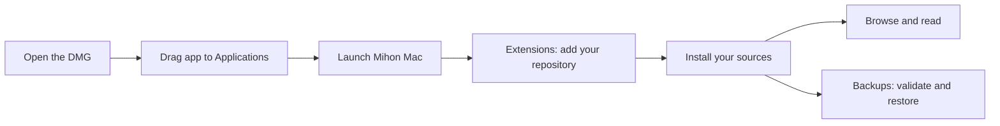
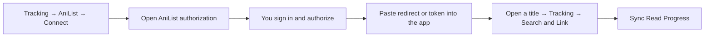
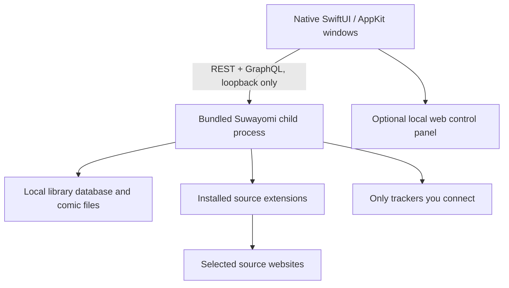

# Mihon Mac — native preview 0.1

A SwiftUI/AppKit Mac application in a fork of Mihon. It bundles Suwayomi Server and a Java runtime for existing Android source extensions. The application does not require Android, an emulator, Java installation, or a separately running server.

**Full Android feature parity is the target, not the status of this release.** Read the [parity and verification matrix](../docs/MACOS_PARITY.md) before migrating your only copy of a library. This is an unofficial project, unaffiliated with Mihon or Suwayomi.

## Install and begin

The Apple Silicon build produces `dist/MihonMac-0.1.0-arm64.dmg`. Open it, drag **Mihon Mac** to **Applications**, and launch it. The locally built preview has an ad-hoc signature; it is not a Developer ID signed or notarized public release. Builds downloaded from another computer still need the normal macOS approval process.



The repository supplied for this port is [Keiyoushi](https://github.com/keiyoushi/extensions):

```text
https://github.com/keiyoushi/extensions/raw/repo/index.pb
```

In **Extensions**, paste that URL, choose **Add Repository**, then install the sources you use. If the catalog is still loading, choose **Refresh List**. A new build does not automatically add third-party repositories. The app installation prepared in this development session is configured with the repository the user selected.

Choose a source in **Browse**. Open a title, choose **Add to Library**, then **Continue Reading**. Arrow keys move between pages, Space advances, and the magnifier selects fit-to-window or zoom. Webtoon mode saves the current visible scroll page, excluding preloaded pages.

For files on your Mac, choose **File → Import Comics…** (⌘O). Supported inputs are CBZ/ZIP archives, folders of images, and series folders containing CBZ/ZIP chapters or chapter-image folders. Imported files are copied, and an existing destination is never overwritten.

For migration, install the corresponding extensions first, then choose **Backups → Choose Backup to Restore…**. The app validates the input, shows missing dependencies, asks before merging, saves the complete input under `android-imports/`, and saves a recovery backup under `pre-restore/`. Keep your Android backup: the engine does not preserve all Android preferences and metadata in its exported backup. Downloaded comics and local comic files must be transferred separately.

**Tracking** exposes MyAnimeList, AniList, Kitsu, MangaUpdates, Shikimori, and Bangumi. Connect your account there, then use a title’s **Tracking** tab to search, link, change status, and sync read chapters. OAuth currently uses a browser authorization and pasted callback URL; AniList also accepts the access token shown by its authorization flow. These authenticated workflows have not yet been verified with real accounts.



AniList’s [official authorization documentation](https://docs.anilist.co/guide/auth/) explains its approval and token flow. Paste authorization details only into the secure fields in the Mac app, not into a chat. Automatic callback capture and automatic progress sync remain parity work.

## What runs on your Mac



The default data directory is `~/Library/Application Support/MihonMac`. The engine listens on `127.0.0.1:45679`, uses its own data root, and stops when the app quits. It does not adopt an unrelated server occupying that port. **Settings → Show Library Folder** opens the data directory. Startup diagnostics are in `engine.log`.

The local control panel in **Settings** provides advanced source preferences and filters, migration, scheduling, and automatic backups while native equivalents are developed. This fallback is explicitly separate from the native application screens.

## Build

Requirements: macOS, Apple command-line developer tools providing Swift, Python 3, and internet access for the initial official runtime download. The package declares macOS 14 as its minimum; runtime validation so far covers this Apple Silicon Mac only. No full Xcode installation or system Java is required here.

```bash
xcode-select --install  # if developer tools are not installed
./macos/scripts/build-app.sh
./macos/scripts/test.sh
open "dist/Mihon Mac.app"
```

The build script downloads the pinned official Suwayomi macOS runtime, checks its SHA-256, compiles Swift, packages the JVM and licenses, creates an icon, verifies an ad-hoc signature, and builds the DMG. It chooses arm64 or x64 for the host architecture. The x64 branch has not been exercised.

Generated downloads and binaries are ignored by Git. To run an isolated test instance:

```bash
MIHON_DATA=/tmp/my-mihon-test MIHON_PORT=45682 \
  "dist/Mihon Mac.app/Contents/MacOS/MihonMac"
```

For development without bundling, set `MIHON_RUNTIME` to the `Contents/Resources/Runtime` directory of a built app before `swift run --package-path macos`. Do not point test data at your only library copy.

## Runtime integration details

Pinned versions and rationale are in [port research](../docs/PORT_RESEARCH.md). Two upstream behaviors required integration work:

1. A small Java bootstrap initializes application configuration before Javalin/GraphQL. The pinned server’s standard entry point can race initialization on a fresh database. `engine/MihonEngine.java` is the complete source; `scripts/build-bootstrap.py` emits its equivalent class so a separate JDK is unnecessary.
2. AndroidCompat/ClassGraph fails to discover resources when the engine jar’s pathname contains spaces. The application stages the checksum-verified jar and bootstrap in a per-user temporary cache with a path containing no spaces. The bundled jar remains unchanged.

The engine’s third-party jar is not patched. See [third-party notices](THIRD_PARTY_NOTICES.md) for licenses and source links. Developer ID signing, hardened-runtime entitlement review, notarization, and Intel/older-macOS testing remain distribution gates.
